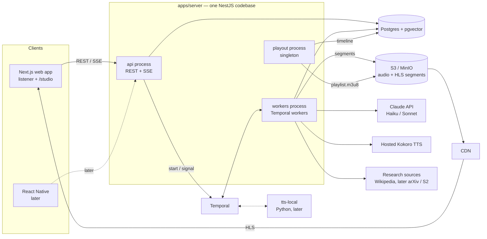
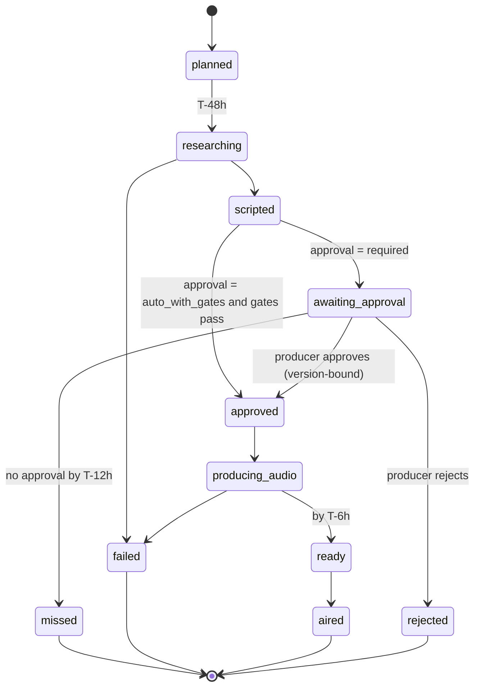

# Architecture

> Status: **designed and approved, not implemented.** Everything below describes the target for
> M1 and later. Where something is deferred, it says so. The reasoning lives in the ADRs.

## Guiding invariants

1. **An LLM never blocks the broadcast.** The real-time path (playout) never waits on AI work. Every AI-produced item has a deadline and a fallback.
2. **Postgres is the source of truth for domain state.** Temporal drives processes. Activities update state idempotently. ([0003](decisions/0003-temporal-orchestration.md))
3. **A workflow per unit of business work, not per event.** High-volume input (questions) lands in a table and is consumed in bounded batches. ([0003](decisions/0003-temporal-orchestration.md))
4. **Modules own their data.** No module reads another module's tables. ([0001](decisions/0001-modular-monolith-process-types.md))
5. **Keep the real-time path thin.** Encoding happens at production time; playout only publishes the playlist, as a pure function of (timeline, now). ([0005](decisions/0005-hls-pre-encoded-segments.md))
6. **The live layer only adds.** If it fails, the approved show plays unchanged. ([0007](decisions/0007-approved-spine-and-live-layer.md))
7. **Enforce mechanically.** Boundaries, determinism and contracts are checked by tooling, not just by convention.

## System overview



## Modules (logical boundaries)

Each module is a NestJS module with its own Postgres schema. Cross-module access goes through the owning module's service API or through events. A lint rule enforces this.

| Module | Owns | Notes |
|---|---|---|
| **catalog** | Shows, presenters, schedule, broadcast window | Presenters are station-wide; shows have 1–2 assigned |
| **editorial** | Weekly plans, assignments, topic candidates | Planner agent (M6) |
| **production** | Episodes, their state machine, scripts and versions, approvals, rendered audio and segments | The core workflow |
| **knowledge** | Sources, documents, chunks, embeddings | M1: Wikipedia documents only. M5: full RAG. |
| **broadcast** | Timeline, airings, filler library, playout state | Playout reads it; production feeds it |
| **interaction** | Questions, moderation results, groups, selections, Q&A segments | M3 |
| **identity** | Users, sessions, roles, allowlist | OIDC, server-side sessions |
| **ops** | Cost ledger, audit log, domain event log | Feeds the dashboard and SSE |

## Process types (deployable units)

One codebase (`apps/server`) with three entry points, plus a Python worker later. Processes are split by **runtime characteristics**, not by domain.

| Process | Entry point | Why separate | Scaling |
|---|---|---|---|
| **api** | `main.api.ts` | Stateless, serves users | Horizontal |
| **workers** | `main.worker.ts` | Long-running, bursty AI and media jobs | By task-queue depth |
| **playout** | `main.playout.ts` | Must never stop; isolated from API deploys and crashes | **Single active instance** (Postgres advisory lock). Its writes are idempotent, so a brief split brain does no harm. |
| **tts-local** (later) | Python (uv) | Runs the TTS model natively on the GPU, outside Docker (macOS has no GPU in Docker) | Fixed; a Temporal activity worker on its own task queue |

## Key flows

### 1. Episode production (M1)



- A Temporal workflow per episode drives the stages. The state lives in `production.episodes`, and transitions are enforced in the domain and in the database.
- Approval is a Temporal **signal**. The deadline is a durable **timer**. On a miss, broadcast assigns a rerun to the slot.
- An approval is bound to a **script version** (a content hash). Changing the script invalidates it.
- The script is **structured data**: `{segment_id, speaker_id, text, citations[]}` per line. TTS runs line by line, using each presenter's voice for the active provider.
- Audio is normalized to a standard loudness at production time, then encoded into HLS segments in object storage.
- Every LLM and TTS call writes a row to the **cost ledger** (`ops`), keyed to the episode.

### 2. Broadcast and playout (M1)

```
workers ──(pre-encoded segments, T-6h; Q&A segments at minute 24)──► S3/MinIO
playout (single instance), every ~6s:
    playlist = f(timeline, now)     ← pure function
    write playlist.m3u8 → S3        ← only after the segments it lists already exist
CDN → hls.js / AVPlayer / ExoPlayer (≈3-segment buffer, ~18–30s behind live)
```

- The timeline is wall-clock based: slots, filler and inserted segments. Filler is cut so each show starts exactly on its slot.
- **Crash recovery** means recomputing the playlist for "now". The media sequence continues and a discontinuity is marked. Listeners hear a brief glitch, not silence.
- **Failover budget:** a new playout must be publishing again within the client buffer (~18s), or listeners stall.
- **Caching:** segments are immutable (long TTL). The playlist gets a ~1–2s TTL.
- The client syncs "now playing" through `EXT-X-PROGRAM-DATE-TIME`, so no server push is needed for it.
- **Risk:** frequent discontinuities between separately encoded clips may cause audible gaps on some players. An M0 spike validates this; the fallback is live encoding in playout ([0005](decisions/0005-hls-pre-encoded-segments.md)).

### 3. Listener Q&A (M3)

```
00:00  question window opens; API inserts questions (unique per user per airing)
       Q&A workflow per airing: every ~30s → moderate a batch (≤500) → group duplicates
18:00  window closes → pick 5 + 2 spares at random (one per group)
       → prepare grounded facts → generate a host dialogue → gates → TTS → segments
24:00  freeze: assemble from what's ready (spares replace failures; 0 ready → standard outro)
25:00  airs
```

The workflow's cost and history size depend on the show's duration, not on submission volume. A flood only grows a queue in a table.

### 4. Live performance layer (M4)

A performer workflow per airing runs during the show, about 30–60 seconds ahead of air. At each point in the spine it decides whether to add an ad-lib, given what has aired, the incoming questions and the persona. The ad-lib passes the gates (no new facts, length, persona), is voiced and segmented, and is inserted **only if ready before its deadline**. Otherwise it's skipped. A kill switch turns the layer off.

## Data stores

| Store | Used for | Why |
|---|---|---|
| **Postgres 17+ with pgvector** | All domain state, the event log, the cost ledger, sessions, and later chunks with embeddings | One transactional store. Hybrid full-text + vector search in SQL. Advisory locks. LISTEN/NOTIFY. |
| **S3 (MinIO locally)** | Rendered audio, HLS segments, playlists | Cheap, immutable objects behind a CDN |
| **Temporal** | Workflow execution state | Durable timers, signals and retries. **Not** queried by the product. |
| No Redis in v1 | — | Postgres and the CDN cover current needs. Added only on a measured need. |

## Technology stack

| Concern | Choice | ADR |
|---|---|---|
| Language | TypeScript core; Python only at the edges | [0002](decisions/0002-typescript-nestjs-python-edges.md) |
| Backend framework | NestJS (Express adapter), class-validator DTOs | [0002](decisions/0002-typescript-nestjs-python-edges.md) |
| Orchestration | Temporal (TS SDK) | [0003](decisions/0003-temporal-orchestration.md) |
| Database and query layer | Postgres + pgvector, Drizzle | [0004](decisions/0004-postgres-pgvector-drizzle-no-redis.md) |
| Streaming | HLS: pre-encoded segments, playlist published by playout | [0005](decisions/0005-hls-pre-encoded-segments.md) |
| LLM | Claude Haiku 5.5 by default, Sonnet 5.5 where evals require it | [0012](decisions/0012-cost-stack-and-budget.md) |
| TTS | Hosted Kokoro as primary, local Kokoro as fallback (same voices) behind `TTSProvider` | [0012](decisions/0012-cost-stack-and-budget.md) |
| Auth | In-house OIDC (Google/GitHub) with server-side sessions | [0011](decisions/0011-identity-and-auth.md) |
| Frontend | Next.js App Router (render only), TanStack Query, hls.js, SSE | [0013](decisions/0013-frontend-nextjs-and-sse.md) |
| Observability | OpenTelemetry → Grafana stack. Langfuse for LLM traces and evals. | [0014](decisions/0014-observability.md) |
| Testing | Jest, Testcontainers, Temporal test kit, fast-check, Playwright | [0015](decisions/0015-testing-strategy.md) |
| Cloud | AWS (from M2), Terraform | [0018](decisions/0018-aws-target-cloud-ready.md) |

## Cross-cutting concerns

- **Auth boundary:** Nest guards deny by default. Every endpoint declares its role. Authorization is checked at the API, never in the frontend.
- **Provider abstraction:** `LLMClient` and `TTSProvider` interfaces have in-repo fakes for tests. Prompts are versioned in git, and each run records its prompt version.
- **Time:** an injected `Clock` everywhere in domain code. Temporal workflow code uses only Temporal's deterministic time.
- **Idempotency:** every activity that spends money (LLM, TTS) or writes externally checks first by a content-hash key.
- **Tracing:** W3C `traceparent` over HTTP, Temporal interceptors into workflows and activities, span links for batch fan-in, `trace_id` on every log line.
- **Cost:** a ledger row per paid call. A cost-per-episode metric. Hard spending caps at each provider.

## Failure model (summary)

| Failure | Expected behavior | Verified in |
|---|---|---|
| A worker crashes mid-activity | Temporal retries. Idempotency prevents paying twice. | M1 |
| The LLM or TTS provider is down or slow | Retries with backoff, then the deadline fallback (rerun / filler / shorter Q&A). The broadcast continues. | M1, M7 |
| The approval deadline is missed | A rerun airs. The episode is marked `missed`. The on-time premiere SLO is charged. | M1 |
| Playout crashes | Another instance takes the lock and recomputes the playlist. A glitch, not silence, within the buffer budget. | M1, M2 |
| Postgres is briefly unavailable | Playout continues from its local lookahead cache | M7 |
| Question flood or spam | Per-user unique constraint, edge rate limits, bounded batches. Workflow cost stays fixed. | M3 |
| Prompt injection in a question | Moderation, structured prompts, output gates. Listener text never selects tools or actions. | M3 |
| A Q&A answer fails its gates | A spare replaces it; if none, a shorter Q&A or the standard outro | M3 |

## Deferred decisions

Each is decided in the milestone that needs it, as a tier 3 decision with an ADR:
- Embedding provider (M3).
- Music and station-ID sources and licenses (M1).
- arXiv / Semantic Scholar ingestion details (M5).
- Temporal Cloud versus the cloud-phase budget (M2).
- Adaptive bitrate renditions (M7).
- How JSON Schema contracts are shared with Python (when tts-local lands).
